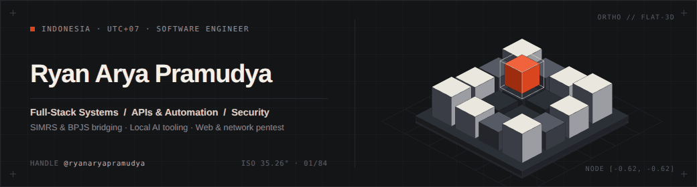

  

Developer from Indonesia (UTC+7). I build full-stack web apps, backend APIs, healthcare integrations, and automation tools — and spend time on web and network security testing.

### Focus

- **Full-Stack & Healthcare Systems** — Web applications, REST APIs, and interoperability bridges for SIMRS and BPJS.
- **API & Automation** — Local AI utilities, service gateways, and automated workflow tooling.
- **Security** — Web and network penetration testing, diagnostics, and CLI security tools.

### Tech Stack

  

- **Languages** — TypeScript, JavaScript, Python, PHP, Go, Rust
- **Frameworks & Runtime** — Next.js, Vue, Node.js, FastAPI, Laravel
- **Data & Infra** — PostgreSQL, Docker, Linux

### Projects

| Project | Summary | Area | Access |
| :--- | :--- | :--- | :---: |
| [**Incompetech&#8209;api**](https://github.com/ryanaryapramudya/Incompetech-api) | Python scraper, FastAPI REST API, and SDK for Kevin MacLeod's royalty-free music catalog | API / Python | `Public` |
| **IndoExam** | Online examination and assessment platform | Full-Stack Web | `Private` |
| **NexaPost** | Multi-workspace content publishing and automation platform | Full-Stack Web | `Private` |
| **IndoAcademy** | Online learning and academy management platform | Full-Stack Web | `Private` |
| [**BOT&#8209;WA**](https://github.com/ryanaryapramudya/BOT-WA) | Automated WhatsApp messaging and command bot | Automation / Node.js | `Public` |

---

  Indonesia (UTC+7) &nbsp;·&nbsp; Open to engineering collaborations and security research.

