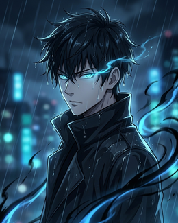

<p align="center">
  
</p>

### Status

<div>

</div>

```yaml
# [ STATUS WINDOW ]
name: Ryan Arya Pramudya
handle: "@ryanaryapramudya"
from: Indonesia (UTC+7)

focus:
  - Full-Stack Web Dev
  - API & Automation
  - Security Pentest

lately:
  - SIMRS & BPJS bridging
  - Local AI & automation tools
  - Network & web security
```

<br clear="right" />

### Tech Stack

<p align="left">
  
</p>

### Projects

| Project | Description | Visibility |
| :--- | :--- | :---: |
| [**Incompetech-api**](https://github.com/ryanaryapramudya/Incompetech-api) | High-performance Python scraper, FastAPI REST API & SDK for Kevin MacLeod's Incompetech music catalog | `public` |
| **IndoExam** | Online examination and assessment platform | `private` |
| **NexaPost** | Content publishing and post automation platform | `private` |
| **IndoAcademy** | Online learning and academy management platform | `private` |
| [**BOT-WA**](https://github.com/ryanaryapramudya/BOT-WA) | Automated WhatsApp bot built with Node.js | `public` |

---

<p align="center">
  「 起きろ。」
</p>
