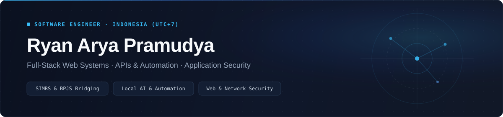

  

Software engineer based in Indonesia (UTC+7) focused on building reliable full-stack web applications, backend APIs, healthcare integrations, and automation systems — with hands-on experience in web and network security testing.

### Focus Areas

- **Full-Stack & Healthcare Integrations** — End-to-end web platforms, RESTful services, and interoperability pipelines for SIMRS and BPJS bridging.
- **API & Workflow Automation** — Local AI tooling, autonomous agent workflows, and service integration gateways.
- **Application & Network Security** — Web/network penetration testing, security diagnostics, and CLI assessment utilities.

### Tech Stack

  

- **Languages:** TypeScript, JavaScript, Python, PHP, Go, Rust
- **Frameworks & Runtime:** Next.js, Vue, Node.js, FastAPI, Laravel
- **Data & Infrastructure:** PostgreSQL, Docker, Linux

### Selected Projects

| Project | Description | Domain | Visibility |
| :--- | :--- | :--- | :---: |
| [**Incompetech&#8209;api**](https://github.com/ryanaryapramudya/Incompetech-api) | High-performance Python scraper, FastAPI REST API, and SDK for Kevin MacLeod's royalty-free music catalog | API / Python | `Public` |
| **IndoExam** | Online examination and assessment platform | Full-Stack Web | `Private` |
| **NexaPost** | Multi-workspace content publishing and automation platform | Full-Stack Web | `Private` |
| **IndoAcademy** | Online learning and academy management platform | Full-Stack Web | `Private` |
| [**BOT&#8209;WA**](https://github.com/ryanaryapramudya/BOT-WA) | Automated WhatsApp messaging and workflow bot | Automation / Node.js | `Public` |

---

  Indonesia (UTC+7) &nbsp;·&nbsp; Open to engineering collaborations, backend architecture, and security research.

